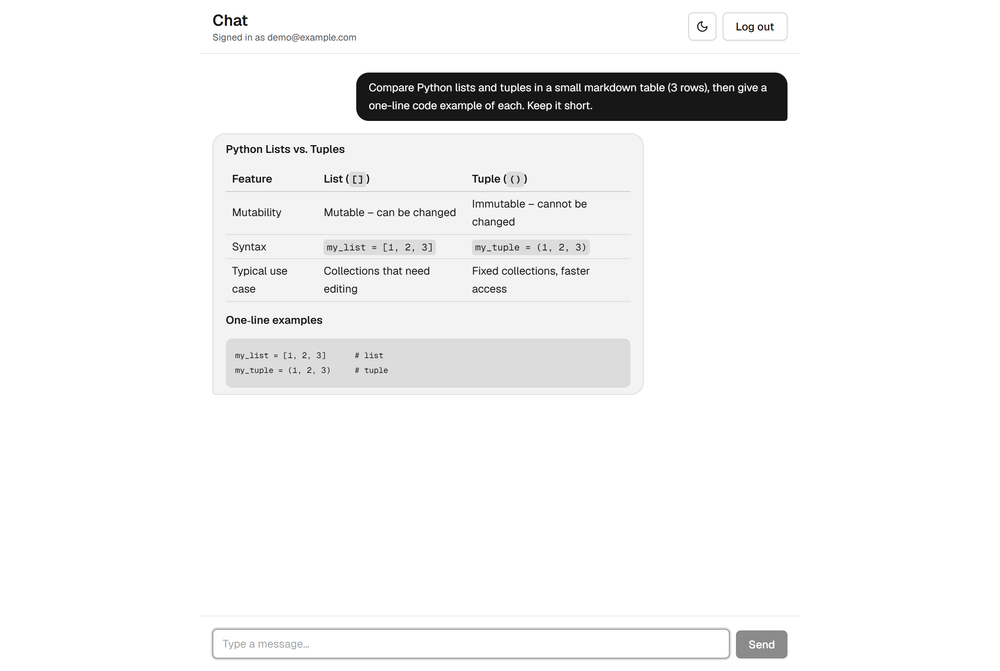
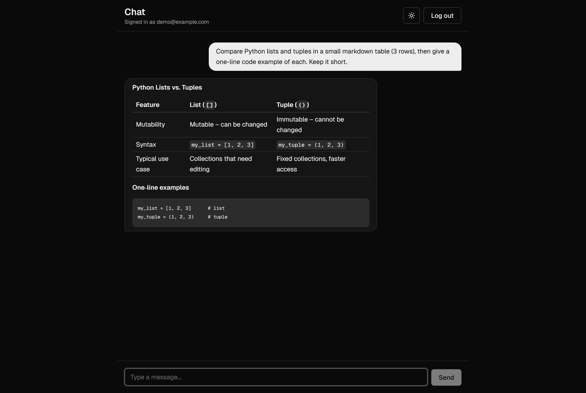
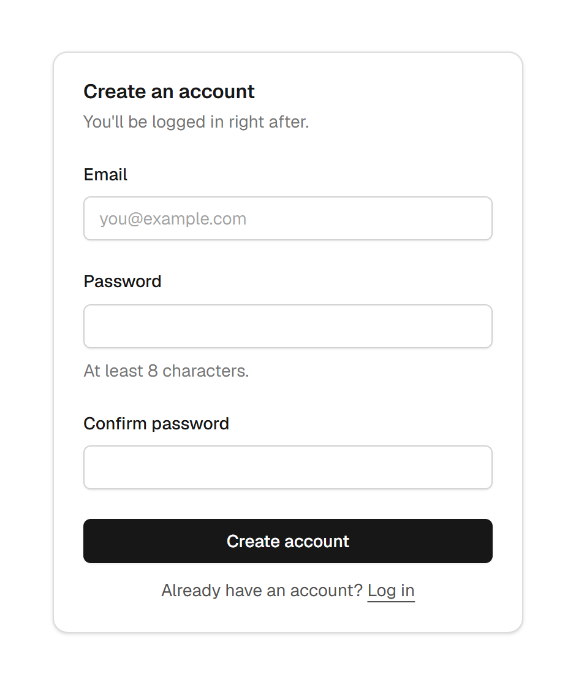
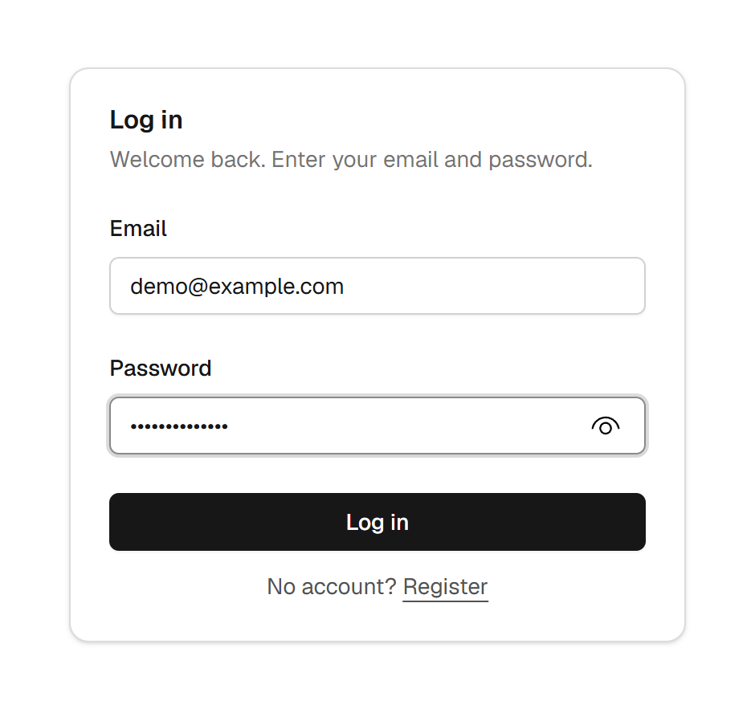
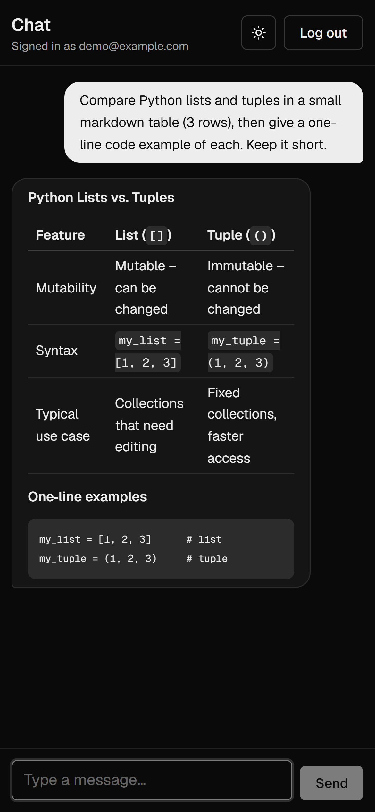

# AI Chat: FastAPI + Next.js

A full-stack AI chat app. You register, log in, and chat with an LLM. Replies stream in as they are
generated, and every conversation is saved to your account.

- **Backend:** [FastAPI](https://fastapi.tiangolo.com/), SQLite via [SQLModel](https://sqlmodel.tiangolo.com/),
  JWT auth with Argon2 password hashing, and chat through [Groq](https://console.groq.com/) using the OpenAI SDK
- **Frontend:** [Next.js](https://nextjs.org/) 16 (App Router), React 19, Tailwind CSS 4,
  react-hook-form + zod, Markdown rendering, light/dark theme



## Features

- Register / log in / log out with JWT tokens stored in a cookie
- Route guard: `/chat` redirects to `/login` when you are not signed in
- Streaming chat replies, with a **Stop** button to cancel mid-answer
- Chat history is saved on the server and reloaded on refresh
- Markdown in replies (tables, lists, code via GitHub-flavored Markdown)
- Error card with **Retry** when a request fails
- Three assistant modes on the API: `default`, `tutor`, `concise`

## Screenshots

**Dark mode.** The app follows your system theme, and the button in the header switches it. This shot
was taken after a page refresh, so the conversation is coming back from the saved history.



<table>
  <tr>
    <th>Register</th>
    <th>Log in</th>
    <th>Mobile</th>
  </tr>
  <tr>
    <td valign="top"></td>
    <td valign="top"></td>
    <td valign="top"></td>
  </tr>
</table>

## Project structure

```
.
├── docs/screenshots/       images used in this README
├── m2-ai-backend/          FastAPI API (auth + chat)
│   ├── main.py             the whole backend: settings, models, routes
│   ├── requirements.txt
│   ├── .env.example        copy to .env
│   └── start-all.cmd       Windows: one-click setup + run both apps
└── m2-ai-frontend/         Next.js app
    ├── app/                pages: /login, /register, /chat
    ├── components/         chat bubbles, Markdown, theme toggle, UI primitives
    ├── lib/                API client, auth cookie helpers, zod schemas
    ├── proxy.ts            route guard (Next.js 16 "proxy", formerly middleware)
    └── .env.example        copy to .env.local
```

## Getting started

### Prerequisites

- Python 3.12+
- Node.js 20+ and npm
- A free Groq API key from https://console.groq.com/keys

### 1. Clone

```bash
git clone https://github.com/Sdb002/ai-chat-fastapi-nextjs.git
cd ai-chat-fastapi-nextjs
```

### 2. Quick start (Windows)

Double-click `m2-ai-backend\start-all.cmd`. On the first run it creates the Python virtualenv,
installs packages, and creates `m2-ai-backend\.env` with a random `SECRET_KEY`. It then stops and
asks you to add your `GROQ_API_KEY`. Add it and run the script again. It creates the frontend's
`.env.local`, runs `npm install`, and opens:

- backend: http://127.0.0.1:8000 (API docs at http://127.0.0.1:8000/docs)
- frontend: http://localhost:3000/register

### 3. Manual setup (any OS)

**a. Backend**

```bash
cd m2-ai-backend
python -m venv .venv
# Windows:      .venv\Scripts\activate
# macOS/Linux:  source .venv/bin/activate
pip install -r requirements.txt

cp .env.example .env      # Windows: copy .env.example .env
# Edit .env: set SECRET_KEY and GROQ_API_KEY.
# Generate a SECRET_KEY with: python -c "import secrets; print(secrets.token_hex(32))"

uvicorn main:app --reload --host 127.0.0.1 --port 8000
```

**b. Frontend** (in a second terminal)

```bash
cd m2-ai-frontend
cp .env.example .env.local   # Windows: copy .env.example .env.local
npm install
npm run dev
```

Open http://localhost:3000/register, create an account, and start chatting.

## Configuration

| File | Variable | Purpose |
|------|----------|---------|
| `m2-ai-backend/.env` | `SECRET_KEY` | **Required.** Signs the JWTs. Keep it secret. |
| | `GROQ_API_KEY` | **Required.** The server refuses to start without it. |
| | `GROQ_MODEL` | Groq chat model id (default `openai/gpt-oss-120b`) |
| | `ACCESS_TOKEN_EXPIRE_MINUTES` | Token lifetime (default `30`). Must match `TOKEN_LIFETIME_MINUTES` in `m2-ai-frontend/lib/auth.ts`. |
| | `DATABASE_URL` | Default `sqlite:///./app.db` |
| | `CORS_ORIGINS` | Comma-separated frontend origins allowed to call the API |
| `m2-ai-frontend/.env.local` | `NEXT_PUBLIC_API_URL` | Backend URL, e.g. `http://127.0.0.1:8000` |

Real `.env` files and the SQLite database (`app.db`) are git-ignored. Only the `.env.example`
templates are committed.

## API

| Method | Path | Auth | Description |
|--------|------|------|-------------|
| GET | `/` | – | Health check |
| POST | `/auth/register` | – | Create an account (`{email, password}`) |
| POST | `/auth/login` | – | Form login, returns a bearer token |
| GET | `/auth/me` | Bearer | Current user |
| POST | `/chat` | Bearer | Full reply in one response |
| POST | `/chat/stream` | Bearer | Reply streamed as `text/plain` chunks |
| GET | `/chat/history` | Bearer | Your saved conversations, oldest first |

Request and response details are in [m2-ai-backend/README.md](m2-ai-backend/README.md) and in the
interactive docs at `/docs` while the backend is running.

## Scripts

| Where | Command | What it does |
|-------|---------|--------------|
| `m2-ai-frontend` | `npm run dev` | Dev server on port 3000 |
| | `npm run build` | Production build |
| | `npm run lint` | ESLint |
| `m2-ai-backend` | `uvicorn main:app --reload` | Dev server on port 8000 |
